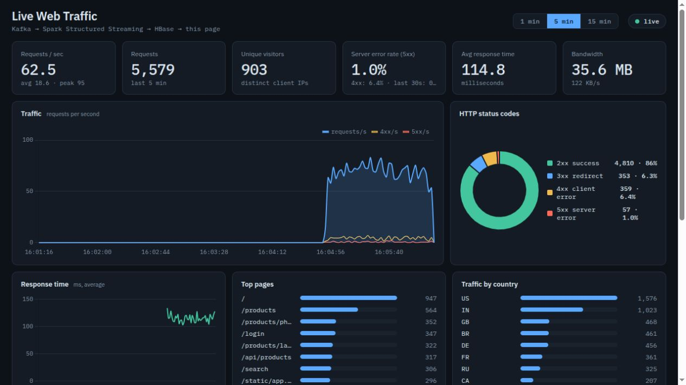
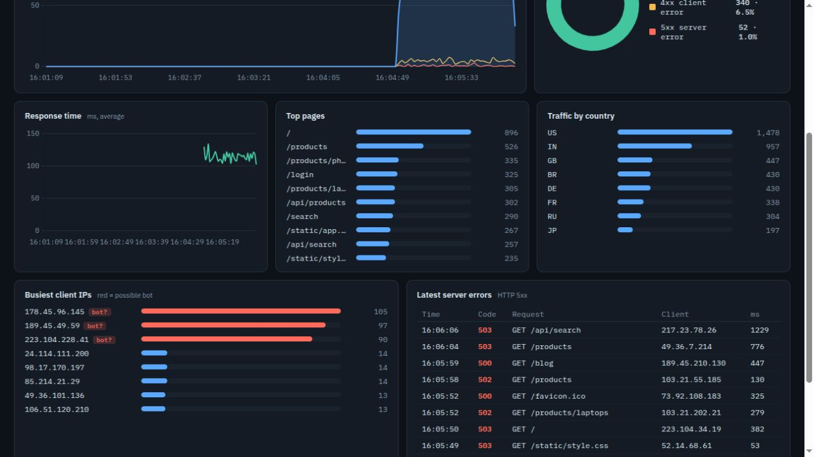
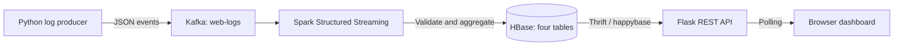

<div align="center">

# Real-Time Website Traffic Dashboard

**From streaming web logs to live traffic insights.**

A complete streaming analytics project built with Apache Kafka, Spark Structured Streaming,
HBase, and Flask, with a responsive dashboard for traffic, latency, errors, and client activity.

[Quick start](#quick-start) · [Screenshots](#application-screenshots) · [Architecture](#architecture) · [Verification](#testing-and-verification) · [Cluster deployment](docs/CLUSTER.md)

</div>



## Overview

Website access logs can reveal traffic spikes, failing endpoints, slow responses, and unusually
active clients. This project turns a continuous stream of JSON log events into live metrics:
Kafka receives the events, Spark validates and aggregates them, HBase stores the results, and a
Flask API serves the dashboard.

Built for **CSBB 422 — Big Data Analytics, Project 11: Real-Time Website Traffic Dashboard**.
The default installation runs as local processes without Docker. A separate deployment guide
covers a Spark master and two worker PCs.

> **Data source:** the included producer generates synthetic access logs, including traffic
> spikes, server-error bursts, and bot-like activity. Screenshots show these generated logs
> processed through the real Kafka → Spark → HBase pipeline, rather than the in-memory preview.

## Features

| Area | Capabilities |
| --- | --- |
| Live traffic | Current, average, and peak requests per second; total requests; bandwidth |
| Visitor activity | Distinct client IPs and busiest clients with a possible-bot heuristic |
| Reliability | HTTP status distribution, 4xx/5xx rates, and recent server-error events |
| Performance | Average response time and a response-time chart |
| Exploration | Top pages, traffic by country, and 1-, 5-, or 15-minute windows |
| Data quality | Malformed-event counting and validation of timestamps, status codes, and numeric fields |
| Operational visibility | Connection status, data-freshness indicators, and an error-rate alert |
| Offline charts | Chart.js is bundled locally; chart rendering does not require a CDN |

Distinct IPs are a visitor proxy, not a count of individual people. Country is supplied by the
log event, and the bot flag is a heuristic rather than a classification model.

## Application screenshots

**Traffic overview.** Live KPIs, request rates, HTTP status distribution, response time, and
page/country rankings are shown above.

**Client activity and server errors.** The lower dashboard identifies unusually active IPs and
lists recent HTTP 5xx events with request details and response times.



Screenshots were captured from a local HBase-backed run on **13 November 2026**. Values vary as
the producer continues sending events.

## Architecture



1. **Ingest:** the producer sends events to a Kafka topic with three partitions, using the client IP as the message key.
2. **Process:** Spark parses JSON with an explicit schema, rejects invalid events, and computes per-second aggregates and distinct client entries.
3. **Persist:** `foreachBatch` writes counters, dimension counts, visitor rows, and recent errors to HBase.
4. **Serve:** Flask reads bounded time ranges and returns dashboard-ready JSON.
5. **Visualize:** the browser polls the API and renders the selected time window with Chart.js.

The default Spark trigger and dashboard polling interval are two seconds. Actual update latency
depends on processing time, storage, and load; the trigger interval is not a latency guarantee.

### Technology stack

| Component | Version / implementation | Purpose |
| --- | --- | --- |
| Apache Kafka | 3.7.0, KRaft mode | Partitioned event ingestion |
| Apache Spark | 3.5.1, Structured Streaming | Validation and distributed aggregation |
| Apache HBase | 2.5.8, Thrift gateway | Time-indexed metric storage |
| Python | Verified with 3.10.12 | Producer, API, and shared modules |
| Flask | 3.0.3 | REST API and dashboard hosting |
| Frontend | HTML, CSS, JavaScript, Chart.js 4.4.1 | Responsive monitoring interface |

## Quick start

### Prerequisites

- Linux, or Ubuntu under WSL2; the supplied scripts use Bash and Linux utilities.
- Java 11 or 17. The verified local run used JDK 11.
- Python 3.9–3.11 with `venv`, plus `curl` and `tar`.
- At least 4 GB RAM; 8 GB or more is recommended for running all services together.
- Several GB of free disk space for extracted runtimes, packages, logs, and data.
- Internet access for initial runtime downloads and the Spark Kafka connector.

On Ubuntu, install the prerequisites if needed:

```bash
sudo apt update
sudo apt install openjdk-11-jdk python3-venv curl
```

A JDK extracted into `vendor/java` is detected automatically when `JAVA_HOME` is unset.

### Start the complete pipeline

```bash
git clone https://github.com/DJ-InfinityCoder/Real-Time-Website-Traffic-Dashboard.git
cd Real-Time-Website-Traffic-Dashboard

./scripts/setup.sh
./scripts/start_all.sh
```

Open **[localhost:8050](http://localhost:8050)**. Initial startup can take longer while HBase
initializes and Spark downloads its Kafka connector. Metrics appear after the first processed events.

| Service | Local address |
| --- | --- |
| Dashboard and REST API | [localhost:8050](http://localhost:8050) |
| Spark application UI | [localhost:4040](http://localhost:4040) |
| HBase master UI | [localhost:16010](http://localhost:16010) |

```bash
./scripts/status.sh        # Inspect service status and recent batches
./scripts/stop_all.sh      # Stop the local pipeline
```

### Preview the interface

```bash
./scripts/run_demo.sh
```

This starts an **in-memory simulator**, labelled `demo data` in the interface. It does not run
Kafka, Spark, or HBase. Stop the full dashboard first, or choose a different port:

```bash
API_PORT=8051 ./scripts/run_demo.sh
```

## Testing and verification

Three checks cover different parts of the system:

```bash
# Unit tests: no external services required
.venv/bin/python -m unittest discover -s tests -v

# Real Spark aggregation with an in-memory HBase fake
source scripts/env.sh
vendor/spark/bin/spark-submit scripts/verify_spark.py

# Real Kafka → Spark → HBase → HTTP API; start the full pipeline first
.venv/bin/python scripts/verify_pipeline.py
```

| Check | Verified result |
| --- | --- |
| Unit suite | 15 tests passed |
| Spark aggregation check | All 80 distinct pages/IPs retained; 80 visitors counted; six invalid events rejected |
| Full pipeline probe | Unique Kafka event found in HBase and returned by the HTTP API in `hbase` mode |
| Browser check | Live charts and metrics rendered; window selection worked |

The full pipeline probe deliberately inserts one HTTP 503 event at a unique `/verify/…` URL.
It rejects demo mode. These are local functional checks, not large-scale performance benchmarks.
See **[the verification record](docs/VERIFICATION.md)** for the environment and observed results.

## Configuration and operations

Environment variables override the defaults:

| Variable | Default | Purpose |
| --- | --- | --- |
| `KAFKA_BOOTSTRAP` | `localhost:9092` | Kafka bootstrap servers |
| `KAFKA_TOPIC` | `web-logs` | Input topic |
| `HBASE_HOST` / `HBASE_PORT` | `localhost` / `9090` | HBase Thrift endpoint |
| `API_PORT` | `8050` | Dashboard port |
| `SPARK_MASTER` | `local[2]` | Local Spark threads or standalone cluster URL |
| `SPARK_TRIGGER_SECONDS` | `2` | Streaming trigger interval |
| `MAX_OFFSETS_PER_TRIGGER` | `10000` | Maximum Kafka records read per trigger |
| `CHECKPOINT_DIR` | `data/checkpoints/web-logs` | Spark query checkpoint location |
| `RATE` | `60` | Producer target rate when launched by `start_all.sh` |

Kafka listener settings are configured separately in `conf/kafka-server.properties`.
Changing `KAFKA_BOOTSTRAP` does not reconfigure the local broker.

### Run components individually

After setup, use separate terminals from the project root:

```bash
./scripts/start_infra.sh
./scripts/start_spark.sh
./scripts/start_dashboard.sh
./scripts/start_producer.sh --rate 100 --error-every 60
```

Producer options include `--rate`, `--spike-every`, `--error-every`, `--duration`,
`--malformed`, and `--stdout`. Use `--help` for details.

### Inspect the pipeline

```bash
tail -f logs/spark.log
curl 'http://localhost:8050/api/snapshot?window=60'

vendor/kafka/bin/kafka-topics.sh \
  --bootstrap-server localhost:9092 --describe --topic web-logs

vendor/hbase/bin/hbase shell
# In the HBase shell:
# scan 'traffic_metrics', {LIMIT => 3}
```

### Three-PC deployment

Follow **[the cluster deployment guide](docs/CLUSTER.md)** to run one Spark master and two
worker PCs. Kafka, standalone HBase, the streaming driver, producer, and dashboard run on
the master PC; Spark executors run on the workers.

The local pipeline has been verified. The physical three-PC deployment has **not** been
verified in this development environment.

## REST API

| Endpoint | Response |
| --- | --- |
| `GET /api/health` | Backend connectivity and active mode |
| `GET /api/snapshot?window=300` | Summary, charts, rankings, freshness, and recent errors |
| `GET /api/timeseries?window=300` | Bucketed request and response-time series |
| `GET /api/top/page?window=300&n=10` | Most requested pages |
| `GET /api/top/country?window=300&n=10` | Traffic by country |
| `GET /api/top/ip?window=300&n=10` | Busiest client IPs |

API windows are clamped to 30–1,800 seconds; ranking size is clamped to 1–50.
Backend failures return HTTP `503`.

## Storage design

Reversed timestamp keys place newer data first in HBase's lexicographic order. Time-range
scans retrieve the selected window without scanning the entire table.

| Table | Row key | Stored data | TTL |
| --- | --- | --- | --- |
| `traffic_metrics` | `rev(second)` | Request counts, bytes, response-time sums, status counts, malformed count | 24 hours |
| `dim_counts` | `dimension#rev(second)#value` | Hits and server errors per page, country, or IP | 24 hours |
| `visitors` | `rev(second)#ip` | Presence of each client IP | 2 hours |
| `recent_errors` | `rev(milliseconds)#nonce` | JSON server-error events | 1 hour |

Atomic counter increments combine contributions from multiple micro-batches. Visitor rows
are deduplicated by IP at query time, and second-resolution keys keep dimension/visitor
windows aligned with request metrics.

## Project structure

```text
api/                  Flask routes and HBase/in-memory stores
common/               Configuration, row-key schema, and HBase writer
conf/                 Kafka and HBase configuration templates
dashboard/            Dashboard UI and bundled Chart.js
producer/             Synthetic access-log generator and Kafka producer
spark_job/            Structured Streaming parsing and aggregation
scripts/              Installation, service control, packaging, and verification
tests/                Unit tests and in-memory HBase fake
docs/
  CLUSTER.md          Master and two-worker deployment guide
  REPORT.md           Course project report
  VERIFICATION.md     Recorded local verification results
  images/             Screenshots from the running application
```

## Troubleshooting

| Symptom | What to check |
| --- | --- |
| Runtime download fails | Re-run setup or use `APACHE_MIRROR` with a mirror carrying the pinned versions. Component-specific URLs can be set with `KAFKA_URL`, `SPARK_URL`, and `HBASE_URL`. |
| Backend unavailable | Check `./scripts/status.sh`, `logs/hbase-thrift.log`, and `logs/hbase/`. |
| No new data | Check `logs/producer.log` and `logs/spark.log`; both processes must be running. |
| Kafka source unavailable in Spark | Check the connector download in `logs/spark.log`, then restart Spark. |
| Java compatibility error | Check `JAVA_HOME` and use Java 11 or 17. |
| Dashboard port is occupied | Start with `API_PORT=8060 ./scripts/start_all.sh`. |
| Kafka data was reset but Spark checkpoint remains | Stop Spark and restart with `./scripts/start_spark.sh --reset` when intentionally starting a new query. |

`./scripts/stop_all.sh --wipe` deletes local stored data, logs, and checkpoints. Use it only
when intentionally discarding the current run. Existing minute-resolution data from older
versions must be archived/reset before using the current second-resolution schema.

## Scope and limitations

- **At-least-once HBase sink:** a crash and replay can increment counters twice; checkpointing alone does not make the sink exactly-once.
- **Lab-scale processing:** aggregates are collected on the Spark driver, and HBase counters use individual RPCs, limiting throughput.
- **Development topology:** the default Kafka broker has replication factor one, and HBase runs standalone. This is not a replicated HBase/HDFS deployment.
- **Synthetic input:** collecting an actual website's access logs requires an ingestion adapter.
- **Local monitoring:** the Flask development server and lab services are intended for a trusted environment, without production authentication.

Potential extensions include an idempotent sink, raw-log archival in HDFS, distributed HBase,
real access-log ingestion, and streaming anomaly detection.
